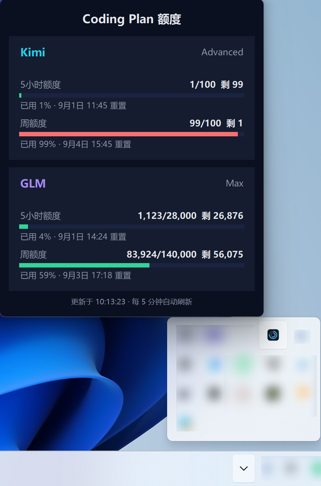

# Coding Plan Tray

<a id="chinese"></a>



**中文** · [English](#english)

一个 Windows 托盘小工具，用来随时查看 Kimi / GLM Coding Plan 的订阅额度：悬停托盘图标即可看到用量卡片，也提供本地 Web 面板。每 5 分钟自动刷新，支持 5 小时窗口、周额度、剩余量与重置时间。

> 仅供个人查看自己的账户额度使用。API Key 只保存在本机环境变量中，不会写入代码或上传到任何第三方服务器。

## 功能特性

- Windows 系统托盘常驻，悬停图标即弹出图形化额度卡片
- 支持 Kimi Coding Plan 与智谱 GLM Coding Plan
- 展示 5 小时窗口、周/订阅周期的已用、剩余、百分比和重置时间
- 内置本地 Web 面板：`http://127.0.0.1:26000`
- 每 5 分钟自动刷新，右键菜单支持“立即刷新”
- API Key 仅从环境变量读取，本地直接请求官方接口

## 快速开始

### 1. 环境要求

- Windows 10/11
- Python 3.10+

### 2. 安装依赖

```powershell
cd D:\Token-usage
python -m pip install -r requirements.txt
```

### 3. 配置 API Key

在 PowerShell 中设置（仅当前会话有效）：

```powershell
$env:KIMI_API_KEY = "你的 Kimi API Key"
$env:ZHIPU_API_KEY = "你的智谱 API Key"
python main.py
```

如需永久保存，可使用系统环境变量，或通过 `setx` 设置（设置后需重开终端）：

```powershell
setx KIMI_API_KEY "你的 Kimi API Key"
setx ZHIPU_API_KEY "你的智谱 API Key"
```

> 只填写你实际使用的平台 Key 即可，未配置的平台会在卡片中显示“未设置 xxx_API_KEY”。

### 4. 运行

```powershell
python main.py
```

程序会常驻系统托盘：

- 悬停图标：查看额度卡片
- 左键/右键菜单 → 打开面板：访问本地 Web 面板
- 右键菜单 → 立即刷新：手动刷新数据
- 右键菜单 → 退出：退出程序

### 5. 桌面快捷方式 / 开机自启（可选）

`setup_shortcut.ps1` 会自动定位项目目录和 Python 解释器，不需要手改路径：

```powershell
powershell -ExecutionPolicy Bypass -File .\setup_shortcut.ps1
```

如需开机自启，将快捷方式创建到启动文件夹：

```powershell
powershell -ExecutionPolicy Bypass -File .\setup_shortcut.ps1 -Startup
```

如果脚本找不到 Python，或你想指定特定解释器，可显式传入：

```powershell
powershell -ExecutionPolicy Bypass -File .\setup_shortcut.ps1 -PythonExe "C:\Path\To\pythonw.exe"
```

> 推荐使用 `pythonw.exe`，启动时不会额外弹出控制台窗口。

## 项目结构

```text
.
├── main.py                 # 主程序：托盘、悬浮卡片、额度抓取与本地 Web 面板
├── setup_shortcut.ps1      # 可选的桌面快捷方式生成脚本
├── make_icon.py            # 图标生成脚本
├── requirements.txt        # Python 依赖
└── assets/
    ├── icon.ico            # 托盘图标
    └── screenshot.png      # README 截图
```

## 常见问题

- **看不到悬浮卡片？** 先确认程序已在系统托盘运行；如果托盘图标被折叠，可在 Windows 设置中将其设为常显。
- **显示“未设置 API Key”？** 环境变量需要在启动 `main.py` 前设置；使用 `setx` 后需要重新打开终端或重新启动程序。
- **Web 面板打不开？** 检查端口 `26000` 是否被占用；本面板只监听 `127.0.0.1`，仅供本机访问。
- **数据多久刷新？** 默认 5 分钟一次，可在右键菜单选择“立即刷新”。

## 开源协议

尚未添加 LICENSE。发布公开仓库前建议补充，例如 MIT License。

---

<a id="english"></a>

# Coding Plan Tray

[中文](#chinese) · **English**

A lightweight Windows system tray utility for checking your Kimi / GLM Coding Plan subscription quotas. Hover the tray icon to see a compact usage card, or open the local web panel. Data refreshes every 5 minutes, covering 5-hour windows, weekly/subscription quotas, remaining tokens, and reset times.

> For personal account monitoring only. API keys stay in local environment variables and are never committed to the repository or sent to any third-party server.

## Features

- Resident Windows tray app with a hover usage card
- Supports Kimi Coding Plan and Zhipu GLM Coding Plan
- Shows used / remaining / percentage / reset time for 5-hour and weekly windows
- Built-in local web panel at `http://127.0.0.1:26000`
- Auto refresh every 5 minutes, with manual refresh from the tray menu
- Reads API keys only from environment variables and calls official APIs directly

## Quick Start

### 1. Requirements

- Windows 10/11
- Python 3.10+

### 2. Install dependencies

```powershell
cd D:\Token-usage
python -m pip install -r requirements.txt
```

### 3. Configure API keys

```powershell
$env:KIMI_API_KEY = "your Kimi API key"
$env:ZHIPU_API_KEY = "your Zhipu API key"
python main.py
```

To persist them as user environment variables (reopen the terminal afterwards):

```powershell
setx KIMI_API_KEY "your Kimi API key"
setx ZHIPU_API_KEY "your Zhipu API key"
```

Only configure the keys you actually use; providers without a key will show a friendly message.

### 4. Run

```powershell
python main.py
```

- Hover the tray icon to view the usage card.
- Use the tray menu to open the local web panel, refresh immediately, or exit.

### 5. Desktop shortcut / autostart (optional)

`setup_shortcut.ps1` automatically resolves the project directory and Python interpreter, so no path editing is required:

```powershell
powershell -ExecutionPolicy Bypass -File .\setup_shortcut.ps1
```

To create the shortcut in the Startup folder instead:

```powershell
powershell -ExecutionPolicy Bypass -File .\setup_shortcut.ps1 -Startup
```

If Python cannot be resolved automatically, pass a specific interpreter:

```powershell
powershell -ExecutionPolicy Bypass -File .\setup_shortcut.ps1 -PythonExe "C:\Path\To\pythonw.exe"
```

## Project Structure

```text
.
├── main.py                 # Tray app, hover card, quota fetching, and local web panel
├── setup_shortcut.ps1      # Optional desktop shortcut generator
├── make_icon.py            # Icon generator
├── requirements.txt        # Python dependencies
└── assets/
    ├── icon.ico            # Tray icon
    └── screenshot.png      # README screenshot
```

## FAQ

- **No hover card?** Make sure the app is running in the system tray; enable “show icon” if Windows hides it.
- **“API key not set”?** Set environment variables before launching `main.py`; reopen the terminal after `setx`.
- **Web panel unavailable?** Check whether port `26000` is already in use. The panel binds to `127.0.0.1` only.
- **Refresh interval?** Every 5 minutes by default; manual refresh is available from the tray menu.

## License

No LICENSE file yet. Adding one (such as MIT) is recommended before publishing the public repository.
